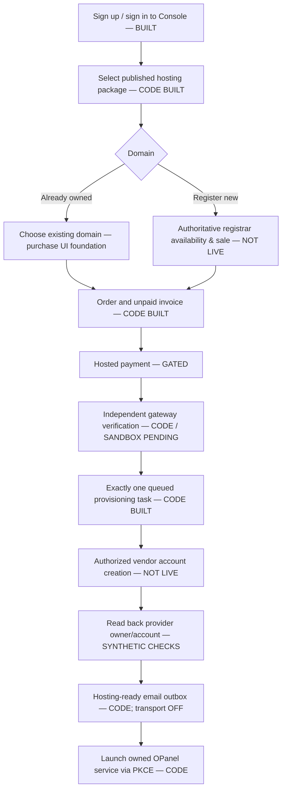
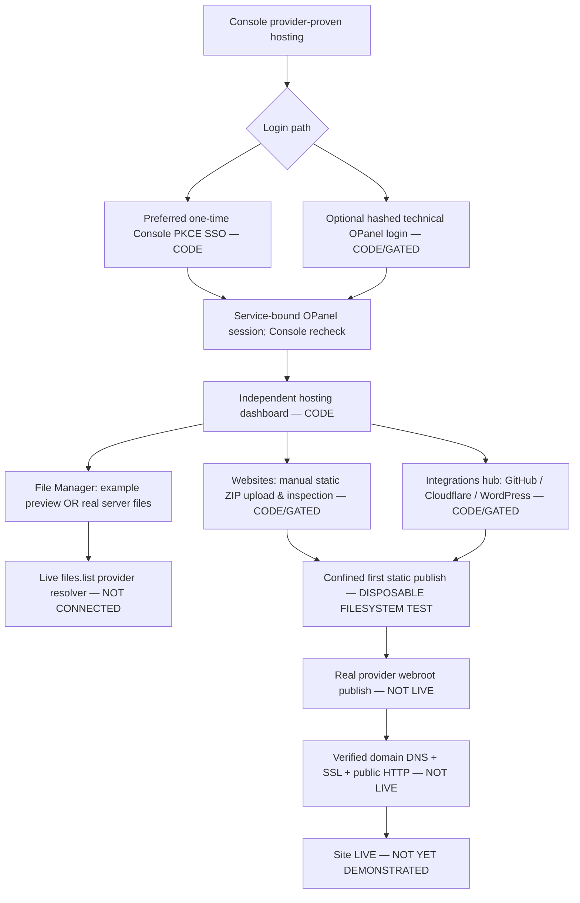

# Octalve Cloud — Console and OPanel Customer Flows, Implementation Truth, Release Blockers
**26 October 2026 · Console PR #14 (stacked on #13) · OPanel independent PR #1 · Review only**

This is a **source-of-truth execution snapshot**, not Production authorization. See [master acceptance matrix](CLOUD_MASTER_ACCEPTANCE_MATRIX_2026-10-26.md), [Production runbook](CLOUD_PRODUCTION_RELEASE_RUNBOOK_2026-10-26.md), and [actual OPanel File Manager UI](https://github.com/octalve-core/octalve-opanel/blob/docs/independent-foundation-design/docs/OPANEL_FILE_MANAGER_UI_AND_LIVE_AUTHORITY_2026-10-26.md).

## Console (WHMCS-like business system) — customer flow

**Built + automated:** Console authentication/RBAC, supplier-backed published catalog and price/markup, unpaid checkout and invoice, gateway callback/webhook/readback logic, settlement guard, durable one-attempt reservation, provider proof/reconciliation contract, OPanel SSO issuer, hosting-ready notice outbox, new real-proof-only hosting/readiness UI, and registrar quote/cost/discount preflight (still no registrar API).

**Unfinished/externally unverified:** registrar-backed live domain availability/registration/renewal; real payment gateway sandbox + live-money merchant acceptance; approved remote DirectAdmin/WHM hosting account creation and timeout reconciliation; account-specific write-worker enrollment and real supplier credentials; host-ready mail sender/retry/bounce; actual customer order-to-site browser E2E, reliable domain/renewal/refund lifecycle; Production migration backup and staged deployment.

**Security correction in this batch:** `services.opanel_overview.active` now means **fresh provider-confirmed binding**, not merely a local `status=active` and account identifier. New `hosting_account_verified`, `dns_public_status=unverified`, and `website_public_status=unverified` fields. A separate `HostingReadiness` component in customer status view shows the difference among account, panel, file manager, DNS and live site. `ClientResourceDetailView` no longer replaces missing API records with DEMO service/domain/order/invoice records or displays a fabricated event timeline. This is a correctness/ownership safeguard, not a UI decoration.

## OPanel (hPanel-like technical service; own DB, repo and releases) — customer flow

**Built + automated:** modern independent Next.js workspace, Django PKCE/SSO/session and expired/suspended denial, optional service-specific technical password enrollment/login (default OFF), snapshot overview, strict management-grant protocol, local native per-account file list/usage/create-folder prototype, account-confined first static-site file publication in synthetic/disposable test, manual static ZIP inspection and UI, File Manager UI with navigation and source transparency, domain/DNS guidance, WordPress installer/GitHub app/Cloudflare zone preflight, mobile Playwright checks and modularity CI.

**Unfinished/externally unverified:** actual customer filesystem readback from an authorized provider/node; safe permanent website releases/rollback and account file writes; provider file adapter or native node OS security/enrollment; separate login MFA/recovery review + HTTPS browser qualification; operational WordPress installation, selected-repo GitHub App permissions/build/publishing, DNS token integration/SSL; live website with expected public content.

## The UI requested: File Manager server contents

The new OPanel UI is at `/modules/files/`. In **My server files**, no entries show until a real permissioned account-scoped provider adapter exists. In **Example preview**, an explicitly labeled demonstration tree shows `public_html/assets`, `images`, `index.html`, `logs`, `backups` and `tmp` with breadcrumbs, folder navigation, file sizes and selected-file details. The demo does **not** assert these folders exist on any customer's actual server.

Manual ZIP website upload remains in `/modules/websites/`. There are no live server changes when the customer selects a demo file or submits archive validation.

## Next execution batch / release blockers

1. Inspect actual isolated Review Neon/Vercel API/frontend and OPanel deployments/commit/secret scopes, fix configured Review blockers without copying Production keys. Get CI and exact deployed browser/DB identity.
2. Connect **one** approved reseller/native test hosting account and prove exact one-time create/readback/domain/owner/service status, no duplicate writes after timeouts.
3. Approve new `files.list` scoped Console entitlement and bind an audited private OPanel adapter to an actual account. Run File Manager against real disposable customer files; no browser-controlled root.
4. Implement first safe remote static ZIP publish, immutable versions/rollback, CSRF and quota/malware/content policy. Verify DNS/TLS/HTTP test domain.
5. Parallel: Paystack/Flutterwave gateway sandbox acceptance and email delivery; domain registrar API/real quote/registration independently gated; GitHub App source, Cloudflare zone and WordPress only when suppliers are verified.
6. Run full cross-product negative and E2E tests; check Production DB migration ledger/backups, deployment alias controls and release switches. Only then request owner final Production promotion.

**No-go:** A passing Django unit test, a synthetic folder tree, a local static file write or an invoice labelled paid is NOT evidence of a hosted website. Production stays unchanged pending actual provider, money, browser and site proof.
