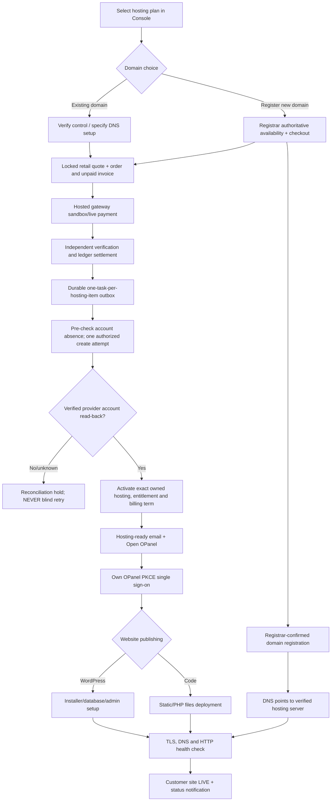

# OCTALVE CLOUD — MASTER EXECUTION PLAN: CUSTOMER PURCHASE TO LIVE WEBSITE TO PRODUCTION
**Version:** 1.0 | **Audited:** 26 October 2026 (Africa/Lagos) | **Classification:** canonical Review execution plan, NOT deployment approval
**Primary owner:** Octalve Cloud | **Implementing repositories:** [Console](https://github.com/octalve-core/octalve-console), [OPanel](https://github.com/octalve-core/octalve-opanel)
**Linked executable checklists:** [Acceptance matrix](CLOUD_MASTER_ACCEPTANCE_MATRIX_2026-10-26.md) · [Release operations](CLOUD_PRODUCTION_RELEASE_RUNBOOK_2026-10-26.md)
**Companion OPanel implementation scope:** see `docs/OPANEL_MASTER_BATCH_SCOPE_2026-10-26.md` in the independent OPanel repository.

> **Single source of truth:** this plan supersedes older narrative handovers for *future task order and release gates*. Older architecture/security docs remain authoritative for existing implementations; never silently change those financial, tenancy or account proof rules. Compare current code/PR commits before a release; the branch heads below are a dated snapshot, not immutable release pins. Work in substantial batches, one coordinated acceptance cycle per batch, and produce actual evidence rather than status guesses.

## 0. Baseline: what is already true

| Area | Audited implementation (code/tests) | Externally qualified? | Scope |
|---|---|---|---|
| Console registration/login/sessions/RBAC | Earlier Production browser acceptance reported pass | Authentication baseline only | Console |
| Published supplier-backed hosting plans, retail price/markup and versioned offers | Code + synthetic CI, PR #13 | No real supplier test purchase | Console |
| Checkout, order and unpaid invoice with idempotency | Code + synthetic CI | Real browser checkout not current head | Console |
| Domain search/availability/registration/transfer/renewal | Guarded unavailable endpoints | **No**; do not imply a domain was registered | Console |
| Paystack/Flutterwave hosted checkout, webhook inbox, independent API read-back | Code + synthetic CI, PR #14, **flags default OFF** | No real sandbox or live provider acceptance | Console |
| Transaction-locked verified settlement and financial replay prevention | Code + synthetic CI; rejects test-mode financial truth | No real-money settlement accepted for this release | Console |
| Paid order → one queued hosting service/task | Code + synthetic CI, PR #14 | No live vendor work | Console |
| Create-account preflight + request format + durable no-network reservation | Code + synthetic CI, PR #14 | No WAN CREATE executor | Console |
| Provider account read-back, reseller/domain match → activate/OPanel proof | Code + synthetic CI | No real DirectAdmin/WHM account acceptance | Console |
| Independent short-lived PKCE SSO and revocable OPanel session | Code + cross-repo CI on *older pinned* Console commit | No deployed browser SSO across current heads | Both |
| OPanel Next.js dashboard and module screens | Code + frontend CI | Not proof of live server control | OPanel |
| OPanel native per-account file/usage worker | Offline prototype, authenticated operations/CI | No installed node, mTLS/enrollment, account OS isolation | OPanel |
| WordPress one-click installer, files upload/website publishing | Planned; modules not operational | **No** | OPanel/provider |
| Secure customer order, payment, domain, hosting-ready and site-live emails | Lifecycle design only; delivery not qualified | **No** | Console |
| Domain DNS, certificate, HTTPS, public website health | Provider/registrar controls currently blocked | **No** | Both/vendor |

**Audited draft PRs (26 Oct):**
- Console PR [#13](https://github.com/octalve-core/octalve-console/pull/13): `89cb1f6094b9bf4058cc8df66fdee8cb74ca9a3f`, base `main`, draft and passing CI.
- Console PR [#14](https://github.com/octalve-core/octalve-console/pull/14): `7be21f4395266de2f562fd21266d56bb253f2285`, base `phase/cloud-provider-authority-preflight` (stacked on #13), draft and passing CI.
- OPanel PR [#1](https://github.com/octalve-core/octalve-opanel/pull/1): `6e60f6ce72597c8d5da4ed0a99da222068616201`, base `main`, draft and passing 3 CI workflows.
- OPanel `.github/workflows/opanel-contract.yml` currently checks out Console commit `a594d15b8e781506553f66e9d2a53301c94d6b7f`, **not latest PR #14**. The contract must be updated to an explicitly qualified new SHA and re-run before cross-repo release. Do not silently point CI at a mutable branch for an authoritative gate.
- Last *reported* Console Production Neon baseline was **49 migrations, 92 tables**. Proposed Review schema has been discussed as 51/96. These are *historic observations*, **not fresh Production database attestations**. Read migration ledger/backup/target at release time; never blindly apply or assume schema state.
- Vercel older API Review deployment returned `DJANGO_SETTINGS_FAILED` because the branch-specific `DJANGO_SECRET_KEY` setting was missing; the team also encountered Hobby build limits. Some older frontend previews were READY but do not prove the latest commits are deployed. `backend/vercel.json` and `frontend/vercel.json` already suppress wildcard Preview deploys. No blanket environment scopes or real Production secrets in Review.

## 1. Product model and architecture — non-negotiable

**Console = WHMCS-like commerce and customer authority.** Owns customer account, MFA/RBAC, products, pricing (supplier cost distinct from customer retail), markup/discount controls, domain registrar rights, order/Invoice/payment truth, refunds, subscriptions, renewals, provider identity and entitlement issuance.

**OPanel = our own independent hPanel-like technical control plane.** Its independent backend/frontend, DB, session, deployment and release pipeline belong only in `octalve-core/octalve-opanel`. OPanel does NOT own billing/payment truth, a duplicate customer password, registrar purchase authority or a second service ownership ledger.

**Hosting execution paths:**
1. **MVP path — vendor-backed shared hosting.** An approved scoped DirectAdmin/WHM reseller account hosts the actual website. Console may order/reconcile accounts; OPanel operates account-scoped resource APIs. We must not mistake a cPanel vendor API, an hPanel screenshot, a queued task, or a local UI for our independent hosting engine.
2. **Expansion — Octalve-native per-account worker.** Work requires secured node enrollment, sandboxed UID/mount/process, persistent audit/replay, secure transport, quotas, rollout/backup. Never expose native management by reusing provider-admin tokens or enabling a broad overview SSO scope.
3. **Runtime tiers:** launch static HTML/CSS/JS and provider-supported PHP/WordPress first. Node/Next.js SSR/Python and full managed VPS are separately qualified products; do not promise them on ordinary shared hosting.

**Customer login:** Console → select owned, active, paid-term, real provider-proven hosting Service → exact HTTPS OPanel callback → 60s single-use PKCE exchange → independent Secure/HttpOnly service-scoped OPanel session → revalidate entitlement on each technical action. No second OPanel customer password. Never email reusable provider admin tokens or store WordPress credentials in Console.

**Financial truth:** a gateway redirect, an unsigned webhook, even a signed successful webhook or test-mode result cannot by itself pay an invoice. Only a separately validated exact gateway reference/amount/currency/provider state may enter the transactional settlement lifecycle; duplicate identity/replay must be idempotent. Test-mode sandbox evidence must never become Production financial authority.

**Hosting truth:** paid ≠ remotely provisioned; provider create response ≠ independently verified account; verified account ≠ website live. Only a fresh exact username/domain/reseller/active readback can bind the account, and OPanel access must be revoked on suspension, expiration, invalid proof, wrong tenant or Console unavailability.

### Approved authentication expansion — 26 October 2026

**The customer now has two planned OPanel entry paths**, without duplicating Console financial identity. (1) Preferred Console-to-OPanel one-time PKCE SSO remains unchanged. (2) Separately gated independent OPanel **technical login** is enrolled/rotated only by the current customer after an authorized SSO session; password is salted/hashed in OPanel's own database; every direct login still requires real-time Console service, owner and provider-binding proof. This is distinct from the vendor's hosting server username/password and the WordPress administrator.

A paid invoice alone cannot send hosting credentials. After **actual vendor account verification**, Console can queue an idempotent hosting-ready email with the real server account username, future OPanel technical username and a secure Console access/setup path. **Never email a reusable plaintext password**, and do not claim queued means delivered. See [credential/integration handoff](CLOUD_TECHNICAL_LOGIN_HOSTING_READY_AND_INTEGRATIONS_2026-10-26.md). Both optional technical login and email queue/delivery remain default disabled until distributed throttling, MFA/recovery, authenticated sender and real-provider acceptance.

OPanel's **Integrations** module is provider-neutral: WordPress/Softaculous (requires proved PHP/DB/installer), Cloudflare (verified DNS zone control) and GitHub (selected repo, immutable static build, account-scoped publish). Planned integration cards **do not** mean live provider operations. Node/Next.js SSR must be disabled on incompatible static/PHP-only plans.

## 2. Target end-to-end customer journey — Namecheap-class outcome, independent execution

**Important split:** hosting first purchase with a domain the customer already owns is launchable *before* in-platform domain registration; new-domain commerce becomes a parallel sales stream only when registrar authority is genuinely operational.

**Customer email lifecycle:** (1) order/invoice with expiry and status; (2) verified payment receipt; (3) registrar-confirmed domain (separate from hosting); (4) hosting account ready with plan/domain/nameserver/IP/account ID and trusted Console login link; (5) published site + HTTPS; (6) renewal/expiry/failed provisioning exceptions. Delivery must be idempotent, templated, transactional, authenticated (SPF/DKIM/DMARC), and never carry plain hosting password. Provide separate audited credential rotation where protocol access is needed.

## 3. Fast execution strategy — six consolidated delivery batches

### Batch 0 — Release infrastructure, contracts and truth baseline (first gate)
**Goal:** one complete isolated, reproducible Review environment and a known matching cross-repository SHA pair. This is a gate, not a cosmetic workstream.
**Console:** inspect Vercel API/frontend target, branch, Root Directory, quota and env names without reading secret values; create/assign unique Review-only secrets and a physically/logically isolated Review database after verifying the chosen Neon branch/project. Fix the API `DJANGO_SECRET_KEY` branch mismatch; verify migrations ledger, API health, domain/CSRF/cookie/redirect safety and frontend BFF origin; no Production schema or secret reuse.
**OPanel:** configure its own isolated database, HTTPS frontend/backend, stable Console callback and confidential client; inspect exact routing for `/auth/start/`, `/auth/callback/`, `/api/session/`, `/auth/logout/`.
**CI:** replace stale OPanel contract pin with audited exact Console release-candidate commit and test the real implementation on disposable databases. Keep Preview deploys manually gated (one coordinated API/frontend/OPanel deployment per reviewed candidate) to protect Hobby quota.
**Pass evidence:** all services show target commit SHA, environment and DB identity; no cross-database leakage; health, signup/login, status, logout, CSRF; no production side effects.
**Blocked if:** no isolated DB, missing branch-scoped secrets, Vercel quota/Preview auth cannot be handled safely. Do not merge to `main` just to obtain a working Preview.

### Batch 1 — One real provider-backed hosting account in isolated test
**Goal:** create or reconcile EXACTLY ONE disposable account on an authorized DirectAdmin or WHM server with zero ambiguous retries.
**Console:** make one persistent dispatched/uncertain/confirmed lifecycle on top of `provisioning.create_attempt`, pinned account username, package, domain, reseller owner and payment authorization; never preflight the *createacct GET* as a harmless GET (it mutates state). Externally scoped credential broker, TLS, DNS resolution/IP restrictions, network egress and allowlist, audit/redaction, timeout and retry policy. Separate provider read-back from creator response; no automatic second write after timeout.
**OPanel:** still overview-only until exact service binding + vendor management capabilities have independently passed.
**Pass evidence:** server states proven account absent before execution, exactly one approved create, exact GET read-back returns same username/domain/owner/package/activity, outage/timeout yields operator-reconcile not second create; queue and proof settle consistently.
**Blocked if:** no scoped DirectAdmin/WHM test server/package/credentials, or firewall cannot exclude internal destinations. No credentials in browser, Git, logs, email.

### Batch 2 — Payment gateway sandbox + financial order state + notifications
**Goal:** authenticate real test-provider responses and prove the financial lifecycle without charging a real card.
**Console:** Paystack/Flutterwave test initialization, callbacks, signed webhook inbox, verification API/readback, reconciliation for duplicated/late/replayed/overpaid/failed payments, order/invoice/receipt truth, hosted return/status UX, proper email outbox. Real-money settlement switch remains OFF. Test-mode charge may not mark a Production invoice paid; for simulated full-funnel browser rehearsal use clearly tagged *synthetic paid fixtures in isolated Review only*, never disguise test funds as live settlement.
**Pass evidence:** test gateway request/response formats validated against provider docs; negative signatures/replays/races/currencies/amounts/foreign invoice; no invoice activation from redirect; exactly-once notification attempts; generated order/invoice/receipt references consistent.
**Parallel:** vendor account acceptance in Batch 1 can proceed on an independent synthetic paid fixture, without real payment provider dependencies.

### Batch 3 — Cross-product OPanel management + website publishing MVP
**Goal:** one actual disposable website becomes live on an existing customer-owned domain/subdomain.
**OPanel:** implement audited per-operation Console entitlements (files.list, files.upload, usage.read, WordPress.install, etc.), not a broad role/grant; server-only scoped adapter; controlled file uploads using canonicalized account-root paths, bounds, quotas, safe ZIP handling and malware policy; static deploy to correct document root using atomic publication; supported PHP app path. WordPress via qualified provider installer if available, otherwise audited install worker handling DB/HTTPS/WordPress secrets; install retries non-destructive.
**Console:** hosting-ready notification, verified server/name-server metadata, owner entitlement and suspend/revoke hooks. Domain reuse path should not require registrar purchase.
**Acceptance:** wrong account denied; DNS resolves to authorized server; correct site content delivered; SSL trusted and renewal scheduled; WordPress login independent from Console and OPanel; on suspension, OPanel actions stop. Test mobile/desktop and browser login/refresh/logout.
**Explicit deferral:** native general-purpose VPS, Node/SSR, wildcard access and full mail hosting.

### Batch 4 — Domain registrar, DNS lifecycle and production-quality operations
**Goal:** customer can register/renew a domain and connect it to hosting, with a separate supplier transaction and full customer status.
**Console:** integrate an approved registrar sandbox/API (never fake availability), TLD-specific registration requirements, real-time supplier cost and retail markup/discount, currency/tax, immutable quotes/expiry, atomic order authority, registration and renewal fulfillment states, contact validation, transfer EPP handling with secret controls, registrar reconciliation/refund/expiry and evidence.
**OPanel:** account-scoped DNS record edits only when domain/zone authority is proven; nameserver changes remain registrar or authoritative DNS provider operations (not assumed from hosting account). Integrate managed SSL issuance/renewal/monitoring and domain/hosting notifications.
**Acceptance:** sandbox or authorized real test domain ownership, registrar confirmation/order IDs, authoritative NS/A/AAAA/MX/TXT verifications, customer isolation, recoverable failed registration, DNS/HTTPS end-to-end. Domain pricing profit separated from registrar settlement.
**Launch decision:** if Batch 4 not qualified, first launch **hosting-only with customer-owned domains**, transparently disabling in-platform domain checkout. Never sell a domain that cannot actually be registered.

### Batch 5 — One coordinated Review acceptance and controlled Production release
**Goal:** launch only what has passed real E2E gates, with owner approval.
**Comprehensive tests:** actual browser customer sign up/sign in → published shared-hosting plan → quote/unpaid invoice → *test payment without funds / isolated synthetic paid fixture* → provider account creation/verification → hosting-ready email → OPanel SSO → static/WordPress site live over HTTPS → revoke on suspension; checkout replay, another customer's service/host, timeouts, provider outage, deleted account, duplicate webhook, expired renewal, DNS mismatch, secrets/permissions, broken SSL, backup restore and mobile checks.
**Release order:** (1) qualify PR #13; (2) qualify stacked PR #14 against current #13 and retarget after #13 merge; (3) qualify OPanel PR #1 with the exact candidate Console SHA. Production deployment must not be auto-assigned untested when merging `main`; stage a Production build with Production env after approved DB migration preflight and promote the *tested production build*, not a Preview-to-Production rebuild without requalification.
**After release:** post-deploy API/frontend/OPanel health, logs, migration ledger, redirect/headers, no secret leakage, email deliverability, queue metrics, rollback control and controlled feature flags. Manual first-client review before broad sales enablement.
**Strict distinction:** code merge != automatic safe feature enablement; each risky flow gets its own observed activation and rollback.

## 4. Parallel work with minimal sequential waiting

| Work lane | Can begin immediately? | Dependency |
|---|---|---|
| Review infra/CI/SSO contract pin | Yes | Dedicated Review DB, env access, protected deployment route |
| Provider adapter/create-worker state machine | Yes, synthetic | Real remote execution waits for approved server and egress |
| Gateway sandbox event coverage | Yes, synthetic | Real sandbox API call waits for TEST keys/isolated Preview |
| Hosting-ready notification outbox and UX | Yes | Actual send waits for SMTP/provider and real status events |
| Static-file upload security/WordPress installer designs | Yes, synthetic | Live site deployment waits for account-scoped provider/test domain |
| Registrar adapter, TLD rules and retail UI | Yes, research/contracts | Domain sale waits for authoritative registrar test account |
| Production merge/migration/deploy | No | All minimum-launch gates, owner release approval |

Use **one Review branch per repository, not branches for every feature**, reuse existing PRs, keep commit pins and the acceptance matrix current, and perform consolidated CI after coherent commits. Only make new PRs when base/branch protection requires one.

## 5. Stop/go and release scope

**MVP sellable hosting (with existing customer domain):** must have working published plan + verified financial settlement on the real live gateway (after sandbox qualification), exactly-once real hosting creation/proof, SSO, scoped static/WordPress deployment, DNS/SSL, notifications, renewals/support handling, production security and monitoring. If WordPress not supported on target hosting plan, advertise static/PHP only until proven.

**Domain sales switch:** remains OFF until real authoritative registration/renewal lifecycle qualifies, independent of hosting account creation.

**Native-hosting switch:** remains OFF until its own OS/node security evidence is complete; do not pretend vendor-backed hosting equals native hosting.

**No-go for ANY live funds:** gateway settlement reconciliation/chargebacks/refunds unreliable; ability to send two create commands on uncertain result; wrong-tenant OPanel access; provider root key in customer UI; unexpected Production DB target; missing functional rollback; absence of actual hosted site acceptance.

## 6. Evidence to persist for each batch

One row in the [acceptance matrix](CLOUD_MASTER_ACCEPTANCE_MATRIX_2026-10-26.md) per criterion with: exact Console and OPanel SHA; test type (`unit`, `disposable-DB`, `sandbox-provider`, `authorized-server`, `browser`, `Production-smoke`); named run/job URL or redacted artifact link; result, reviewer, date, required next action. **Never** mark external acceptance PASS based on mocked responses. Never put keys, tokens, password, payment customer data or full vendor responses in reports.

Owner receives **one consolidated batch report**: done / tested / genuinely blocked / changed files / PRs / release risks / what to inspect / next ready batch. Do not interrupt after every small file.

## 7. Authoritative existing docs / code entry points

- Console `docs/CLOUD_RELEASE_AUDIT_AND_RECOVERY_2026-10-26.md` and `docs/CLOUD_PAYMENT_TO_HOSTING_FULL_FUNNEL_BATCH_2026-10-25.md`; `backend/catalog/offer_management.py`; `backend/payments/hosted_checkout.py`, `readback.py`, `settlement.py`, `webhook_inbox.py`; `backend/provisioning/fulfillment.py`, `create_attempt.py`, `vendor_create_contract.py`, `reconcile.py`; `backend/opanel_bridge/`.
- OPanel `docs/OPANEL_CONSOLIDATED_BATCH_AND_ACCEPTANCE_2026-10-25.md`, `backend/bridge/management.py`, `native_agent/worker.py`, `frontend/src/components/Workspace.tsx`, and `.github/workflows/opanel-contract.yml`.
- Official references (validate against the actual provider version at use time): [DirectAdmin API](https://docs.directadmin.com/developer/api/), [DirectAdmin legacy create-user](https://docs.directadmin.com/developer/api/legacy-api.html), [WHM API](https://api.docs.cpanel.net/), [Paystack transaction verification](https://paystack.com/docs/api/transaction/), [Flutterwave developer docs](https://developer.flutterwave.com/), [Vercel staged Production promotion](https://vercel.com/docs/deployments/promoting-a-deployment).

**Change control:** update this document and acceptance matrix only to reflect evidence; keep historical statuses legible. All action links/commits must be re-verified after new code merges.